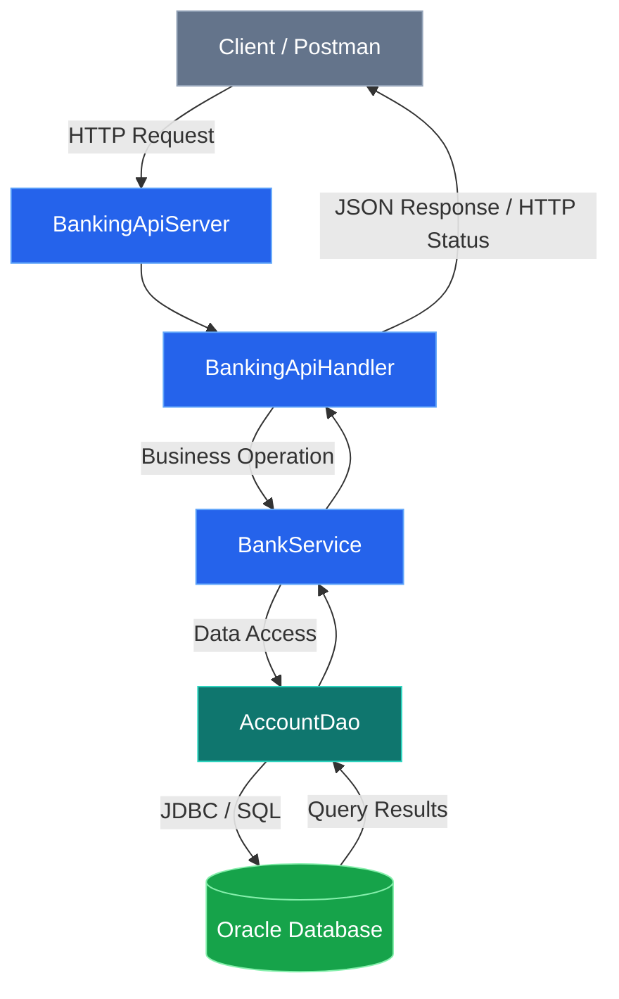

# 🏦 Banking Management System


A **Java-based Banking Management System** that provides REST APIs for managing bank accounts and performing banking transactions using Core Java, JDBC, Oracle Database, and a lightweight HTTP server.

This project demonstrates how to build a backend application with a layered architecture **without using Spring Boot**.

The goal is to understand how HTTP requests, request handlers, business logic, database access, and persistent storage work together in a Java backend application.

---

## 🚀 Why This Project Exists

This project was developed as a practical learning project to strengthen backend engineering skills.

The main objectives are:

- Build REST APIs using Core Java.
- Understand HTTP methods, routes, request bodies, and responses.
- Implement a layered backend architecture.
- Separate business logic from HTTP handling and database operations.
- Connect Java applications to Oracle Database using JDBC.
- Perform database operations using SQL and prepared statements.
- Handle account creation, deposits, withdrawals, and transfers.
- Use Maven to manage dependencies and build the application.
- Test REST endpoints using Postman.
- Understand database transactions and rollback behavior.

The long-term goal is to develop the practical skills required for professional **Java backend development**.

---

## ✨ Key Features

| Feature | Description |
|---|---|
| Account Management | Create and retrieve bank accounts |
| Account Listing | Retrieve all available accounts |
| Deposit | Add money to an account |
| Withdrawal | Withdraw money subject to balance validation |
| Money Transfer | Transfer funds between accounts |
| REST API | Expose banking operations through HTTP endpoints |
| Database Integration | Store account information in Oracle Database |
| JDBC | Execute database operations from Java |
| JSON Processing | Serialize and deserialize JSON using Jackson |
| Layered Architecture | Separate handlers, services, and data access |
| Transaction Management | Commit successful transfers and roll back failed transactions |
| API Testing | Test requests and responses using Postman |

---

## 🏛️ Architecture Overview

### High-Level Architecture

The application follows a layered architecture in which each component has a specific responsibility.



### Component Responsibilities

| Component | Responsibility |
|---|---|
| `BankingApiServer` | Starts the HTTP server and registers the API handler |
| `BankingApiHandler` | Handles incoming HTTP requests, routes, JSON, and HTTP responses |
| `BankService` | Contains banking business logic and validations |
| `AccountDao` | Performs account-related database operations |
| `DatabaseConnection` | Establishes connections to Oracle Database |
| `Account` | Represents a bank account and its associated data |
| `BankingApplication` | Provides the original console-based banking application |

### Request Flow

1. A client sends an HTTP request using Postman.
2. `BankingApiServer` receives the request through the registered HTTP context.
3. `BankingApiHandler` identifies the requested endpoint and processes the request.
4. `BankService` performs the relevant banking operation and business validations.
5. `AccountDao` executes the required SQL statements through JDBC.
6. Oracle Database stores or retrieves the account information.
7. The handler returns an HTTP response, generally containing JSON for API operations.

This separation improves code organization, readability, testing, and maintainability.

---

## 🔄 Banking Operations

### 1. Create Account

Creates a new bank account and generates its account number using the Oracle database sequence.

### 2. View Account

Retrieves an account using its account number.

### 3. View All Accounts

Returns the available bank accounts stored in the database.

### 4. Deposit Money

Adds the specified amount to an existing account after validating the request.

### 5. Withdraw Money

Withdraws money from an account, subject to the application's validation rules and available balance.

### 6. Transfer Money

Transfers money from one account to another.

The database transaction is designed to ensure that the debit and credit operations succeed together. If the transaction fails, it can be rolled back to prevent a partially completed transfer.

---

## 🔗 REST API Documentation

**Base URL**

```text
http://localhost:8080
```

| Method | Endpoint | Description |
|---|---|---|
| `GET` | `/accounts` | Retrieve all accounts |
| `POST` | `/accounts` | Create an account |
| `GET` | `/accounts/{accountNumber}` | Retrieve a specific account |
| `POST` | `/accounts/{accountNumber}/deposit` | Deposit money |
| `POST` | `/accounts/{accountNumber}/withdraw` | Withdraw money |
| `POST` | `/transfers` | Transfer money between accounts |

### Example Requests

#### Create an Account

```http
POST /accounts
Content-Type: application/json
```

Example request body — confirm the field names against your handler's actual request DTO before using it:

```json
{
  "accountHolderName": "Sriram Test",
  "balance": 1000
}
```

#### Retrieve All Accounts

```http
GET /accounts
```

#### Retrieve a Specific Account

```http
GET /accounts/100001
```

Replace `100001` with an account number that exists in your database.

#### Deposit Money

```http
POST /accounts/100001/deposit
Content-Type: application/json
```

Example request body:

```json
{
  "amount": 500
}
```

#### Withdraw Money

```http
POST /accounts/100001/withdraw
Content-Type: application/json
```

Example request body:

```json
{
  "amount": 200
}
```

#### Transfer Money

```http
POST /transfers
Content-Type: application/json
```

Example request body — confirm the exact property names against your handler:

```json
{
  "fromAccountNumber": 100001,
  "toAccountNumber": 100003,
  "amount": 250
}
```

Use existing account numbers and ensure the sender has sufficient funds.

### HTTP Status Codes

The API handler supports the following response status codes, depending on the operation and outcome.

| Status Code | Meaning |
|---|---|
| `200 OK` | Request completed successfully |
| `201 Created` | Resource created successfully |
| `400 Bad Request` | Invalid request or validation failure |
| `404 Not Found` | Requested resource or route not found |
| `405 Method Not Allowed` | Unsupported HTTP method |
| `409 Conflict` | Operation conflict |
| `500 Internal Server Error` | Unexpected server-side failure |

The precise status code depends on the endpoint and the condition encountered.

---

## 🛠️ Tech Stack

| Component | Technology / Approach |
|---|---|
| Programming Language | Java 25 |
| Build Tool | Apache Maven |
| HTTP Server | `com.sun.net.httpserver.HttpServer` |
| API Style | REST |
| Database | Oracle Database 21c |
| Database Connectivity | JDBC |
| JSON Processing | Jackson Databind |
| Data Access | DAO pattern |
| Architecture | Layered architecture |
| API Testing | Postman |
| Development Environment | Eclipse IDE |

### Why These Technologies?

- **Core Java:** Understand backend development fundamentals without depending on a full application framework.
- **Java HttpServer:** Create an HTTP server and register request handlers.
- **JDBC:** Connect Java code to a relational database and execute SQL statements.
- **Oracle Database:** Persist account information beyond the application's lifetime.
- **Jackson:** Convert JSON request bodies into Java objects and Java results into JSON.
- **Maven:** Manage dependencies and compile the project consistently.
- **Postman:** Send HTTP requests and inspect API responses.

---

## 🗄️ Database Design

The project uses Oracle Database 21c for persistent account storage.

### Database Objects

| Object | Purpose |
|---|---|
| `BANKING_APP.ACCOUNTS` | Stores bank account records |
| `BANKING_APP.ACCOUNTS_SEQ` | Generates account numbers |

### Account Table

The DAO uses the following account columns:

| Column | Purpose |
|---|---|
| `ACCOUNT_NUMBER` | Unique account identifier |
| `ACCOUNT_HOLDER_NAME` | Account holder's name |
| `BALANCE` | Current account balance |

### Database Connection

The database connection is configured using environment variables rather than hardcoding credentials in the source code.

| Environment Variable | Purpose |
|---|---|
| `BANKING_DB_URL` | Oracle JDBC connection URL |
| `BANKING_DB_USERNAME` | Database username |
| `BANKING_DB_PASSWORD` | Database password |

Example JDBC URL:

```text
jdbc:oracle:thin:@//localhost:1521/orclpdb.lan
```

Use the service name and credentials configured in your own Oracle installation.

**Important:** Never commit real database passwords, private credentials, or `.env` files to a public repository.

---

## 📁 Project Structure

```text
BankingManagementSystem/
│
├── src/
│   └── main/
│       └── java/
│           ├── banking/
│           │   ├── Account.java
│           │   ├── BankService.java
│           │   ├── BankingApiServer.java
│           │   └── BankingApplication.java
│           │
│           ├── banking/database/
│           │   ├── AccountDao.java
│           │   ├── AccountDaoTest.java
│           │   └── DatabaseConnection.java
│           │
│           └── banking/handler/
│               └── BankingApiHandler.java
│
├── .gitignore
├── pom.xml
└── README.md
```

*Note: This tree illustrates the project's logical structure. The displayed package paths should be adjusted if the current source files differ.*

### Package Responsibilities

- `banking`: Account model, business service, application entry point, and HTTP server.
- `banking.database`: Database connection, DAO operations, and database testing.
- `banking.handler`: HTTP routing, request processing, and response handling.

---

## ⚙️ Prerequisites

Install or configure the following before running the application:

- Java Development Kit (JDK) 25
- Oracle Database 21c
- Apache Maven, or Eclipse with Maven build support
- Postman for API testing
- Git for cloning the repository

Verify Java in a terminal:

```bash
java --version
```

Verify Maven if installed:

```bash
mvn -version
```

---

## 🚀 Getting Started

### 1. Clone the Repository

```bash
git clone https://github.com/vedulasriram/banking-management-system.git
```

Navigate into the project:

```bash
cd banking-management-system
```

### 2. Configure Oracle Database

Ensure Oracle Database is running and the required schema objects exist:

```text
BANKING_APP.ACCOUNTS
BANKING_APP.ACCOUNTS_SEQ
```

Configure the three database environment variables expected by `DatabaseConnection.java`:

```text
BANKING_DB_URL
BANKING_DB_USERNAME
BANKING_DB_PASSWORD
```

Set them securely in your local environment. Do not put actual passwords in this README.

### 3. Build the Project

From a terminal where Maven is installed:

```bash
mvn clean compile
```

In Eclipse, you can also right-click the project and select **Run As → Maven build...**, then enter:

```text
clean compile
```

Wait for the build to finish successfully.

### 4. Start the REST API Server

In Eclipse, open:

```text
src/main/java/banking/BankingApiServer.java
```

Run `BankingApiServer.java` as a Java application with the Maven dependencies available on the classpath and the database environment variables configured.

When the server starts successfully, the API listens on port `8080`.

If the port is already in use, resolve the conflict before starting the application.

### 5. Test the API

Open Postman and send a request to:

```text
http://localhost:8080/accounts
```

For example, choose `GET` to retrieve accounts or `POST` to create an account. Use the request examples in the API documentation above, after confirming the expected JSON field names.

---

## 🧪 Testing with Postman

Postman can be used to test each endpoint independently.

Suggested testing sequence:

1. Start the API server.
2. Create an account.
3. Retrieve the created account.
4. Retrieve the account list.
5. Deposit money.
6. Withdraw money.
7. Transfer money between two existing accounts.
8. Test invalid account numbers and invalid request values.
9. Verify the resulting account balances in the API and Oracle Database.

### Test Scenarios

| Scenario | Expected Check |
|---|---|
| Create account | Account is stored and an account number is returned |
| Retrieve account | Correct account information is returned |
| Deposit | Balance increases by the deposit amount |
| Withdraw | Balance decreases when the withdrawal is permitted |
| Transfer | Sender and receiver balances reflect the transfer |
| Invalid account | Appropriate error response is returned |
| Invalid request | Validation error is returned |
| Failed transfer | Transaction is not partially committed |

Actual responses depend on the endpoint implementation and database state.

---

## 🔐 Security Considerations

This is a learning and portfolio project, not a production-ready banking system.

Before using it in a real environment, consider implementing:

- Authentication and authorization.
- HTTPS and secure network configuration.
- Input validation and stricter request-size limits.
- Secure handling and rotation of database credentials.
- Audit logging for financial transactions.
- More comprehensive automated tests.
- Appropriate transaction limits and concurrency testing.
- Protection against unauthorized access to account information.

The current application does not implement authentication or authorization. Do not expose it directly to the public internet or untrusted networks.

---

## 🗺️ Future Improvements

Potential next steps for the project include:

- [ ] Add automated unit and integration tests.
- [ ] Improve API documentation with OpenAPI/Swagger.
- [ ] Add transaction history.
- [ ] Introduce centralized exception handling.
- [ ] Add pagination for account listing.
- [ ] Improve structured logging.
- [ ] Add authentication and role-based authorization.
- [ ] Add configuration profiles for development and testing.
- [ ] Add Docker-based local development.
- [ ] Implement monitoring and health-check endpoints.

These are planned improvements, not claims about existing functionality.

---

## 📚 What I Learned

Through this project, I am developing practical experience with:

- Core Java and object-oriented programming.
- REST API fundamentals and HTTP request handling.
- Layered architecture and separation of responsibilities.
- JDBC and relational database integration.
- SQL queries and prepared statements.
- Database transactions and rollback.
- JSON serialization and deserialization.
- Maven dependency management.
- API testing using Postman.
- Version control and publishing projects on GitHub.

---

## 👨‍💻 Author

**Sriram**

Java Backend Development | Core Java | JDBC | Oracle Database | REST APIs

GitHub: [@vedulasriram](https://github.com/vedulasriram)

### Project Repository

[Banking Management System — GitHub](https://github.com/vedulasriram/banking-management-system)

---

⭐ If you find this project useful for learning Java backend development, feel free to explore the source code and suggest improvements.
